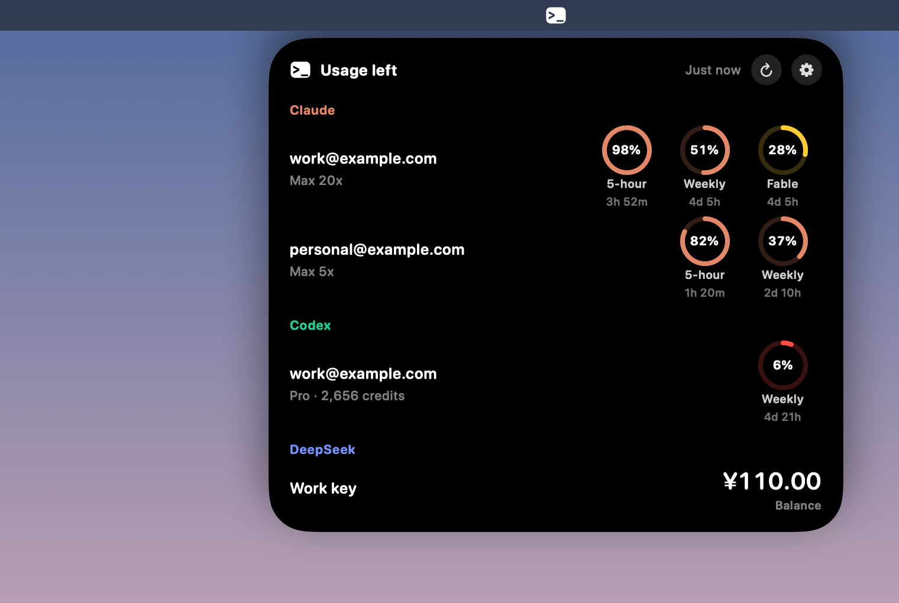
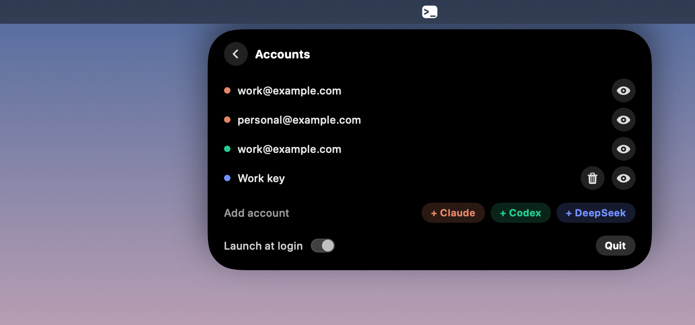

# UsageIsland

**English** | [한국어](README.ko.md)

A macOS menu bar app that shows how much usage you have left on Claude Code and Codex, plus your DeepSeek API balance.
Instead of running `claude usage` or opening a website, click the `>_` icon in the menu bar and a Dynamic Island-style
panel opens right below it.



*The real app UI, rendered with sample accounts.*

## Install

**[Download UsageIsland.zip](https://github.com/youngnfire/UsageIsland/releases/latest/download/UsageIsland.zip)**, unzip
it, move `UsageIsland.app` to your Applications folder, and open it. The app is notarized by Apple, so macOS won't block it.

Or install from the terminal:

```sh
curl -L -o /tmp/UsageIsland.zip https://github.com/youngnfire/UsageIsland/releases/latest/download/UsageIsland.zip
ditto -x -k /tmp/UsageIsland.zip /Applications
open /Applications/UsageIsland.app
```

Requires macOS 14 or later, on Apple Silicon or Intel. The app turns on launch at login the first time it runs. You can
turn this off from the gear button in the panel.

## Features

- **Usage per account:** rings for the 5-hour, weekly, and per-model limits, with the time left until each one resets.
- **DeepSeek balance:** connect an API key to see your balance.
- **Multiple accounts:** several accounts on the same service appear side by side.
- **Warning colors:** a ring turns yellow at 30% remaining or less, and red at 10% or less.
- **Expired logins:** a button appears when you need to log in again, and the app reads the account again once you finish.
- **English and Korean:** the app uses whichever comes first in your Mac's language list, and English if neither is listed.
  To choose one yourself, run `defaults write com.ynf.usageisland AppleLanguages -array en` (or `ko`) and reopen the app.



## Connecting accounts

| Service | What you need |
|---|---|
| Claude | Appears automatically if you're logged in to the Claude Code CLI on this Mac |
| Codex | Appears automatically if you're logged in to the Codex CLI on this Mac |
| DeepSeek | Paste an API key into the panel. A key is saved only if a balance lookup succeeds |

To add more accounts, click the gear button.

- **Claude / Codex:** a Terminal window opens. After you log in through the browser, the login is saved in a new folder
  such as `~/.claude-2` or `~/.codex-2`, and the account appears automatically. To use that account from the CLI, point
  `CLAUDE_CONFIG_DIR` or `CODEX_HOME` at the same folder.
- **DeepSeek:** enter a name and an API key.

The app looks for accounts in `~/.claude.json` and in any readable `.claude`, `.claude-*`, `.codex`, or `.codex-*` folder
inside the home folders under `/Users`.

## Data and security

UsageIsland has no server of its own and no analytics.

| Service | Where usage comes from | How credentials are handled |
|---|---|---|
| Claude | `api.anthropic.com/api/oauth/usage` | Reads Claude Code's Keychain item for each request and uses the token only for that request |
| Codex | `account/rateLimits/read` on `codex app-server` | The app doesn't use the token. From `auth.json` it reads only the email and account ID for display |
| DeepSeek | `api.deepseek.com/user/balance` | Stores the API key in the Keychain and uses it only for this request |

- **Your logins stay untouched.** If the app used a refresh token, your CLI login could stop working, so each CLI handles
  its own renewal. When a Claude token expires, the app runs `claude -p /cost` with hooks and MCP turned off, at most once
  every 30 minutes. This command doesn't call a model.
- **Unknown values aren't guessed.** If a response format changes, the app shows "Couldn't read response" instead of
  100%. If a lookup fails, the last value stays on screen in gray, along with how old it is.
- **API calls are kept low.** The app reads usage every 10 minutes, and when you open the panel if the last read is more
  than a minute old. If a service rate-limits an account, the app leaves that account alone until the retry time.

Settings are stored in `~/Library/Application Support/UsageIsland/settings.json`, which contains no secrets.

## Limitations

The Claude and Codex usage sources aren't official public APIs, so changes on their side can break them. This project isn't
affiliated with Anthropic, OpenAI, or DeepSeek.

## Building from source

Requires Xcode.

```sh
Scripts/test.sh                        # Run the core logic tests
Scripts/build-app.sh --install         # Build, install to /Applications, and launch
Scripts/snapshots.sh <folder>          # Render the panel to PNG with sample data
Scripts/verify-real-window.sh <folder> # Run a debug build in the real menu bar (reads your real accounts)
Scripts/release.sh                     # Build a signed, notarized release (see the script header for required variables)
```
